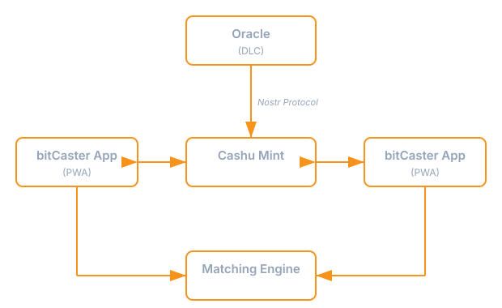

bitCaster は、オープンなプロトコルでつながった、いくつかの独立した部品でできています。ウォレットはあなたのブラウザーの中にあり、それ以外はすべてのユーザーが共有します。

## アプリ

アプリはブラウザーで動き、ウォレットを保持します。トークンを動かすときはミントと、マーケットを読んだり注文を出したりするときはマッチングエンジンと通信します。

## ミント

ミントは ecash とマーケットのシェアを発行し、その裏付けとなる bitcoin を保管します。マーケットの結果判定時には、オラクルの署名を検証し、当たったシェアに払い出します。ベータ期間中のミントは、bitCaster が運営する 1 つだけです。ミントが稼働し続け、出金に応じることを、ユーザーは信頼することになります。

## マッチングエンジン

マッチングエンジンは、マーケットごとの注文板を管理し、買い手と売り手をマッチングし、価格をリアルタイムで配信します。ウォレットを預かることはありません。注文ごとに受け取るのは、その注文のためにロックされたトークンだけで、あなたが同意していない宛先へ送ることはできません。

## オラクル

オラクルは、事前に出来事をアナウンスし、後からその結果に署名します。オラクルは [Discreet Log Contract (DLC)](https://www.dci.mit.edu/projects/discreet-log-contracts) の仕組みに由来し、bitCaster からは独立しています。アナウンスと結果は Nostr リレーを通って届きます。リレーはメッセージを運ぶだけです。結果を有効にするのはオラクルの署名であり、ミントとマッチングエンジンの両方がそれを検証します。

## オープンソースの範囲

アプリ、コマンドラインクライアント、ミント、プロトコル仕様は、すべて [bitCaster リポジトリ](https://github.com/joemphilips/bitCaster)で公開されています。資金に触れる部分はすべて自分で確認できます。マッチングエンジンだけはクローズドソースです。スパム対策の裏をかかれにくくするためです。ただし [API 仕様](https://github.com/joemphilips/bitCaster/tree/main/BitCaster.MatchingEngine.Contracts/specs)は公開されているので、誰でも対応するクライアントを作れます。
