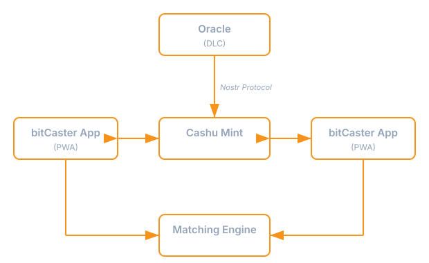

bitCaster is a handful of independent pieces that talk to each other over open protocols. Your wallet lives in your browser. Everything else is shared by all users.

## The app

The app runs in your browser and holds your wallet. It talks to the mint to move tokens, and to the matching engine to read markets and place orders.

## The mint

The mint issues your ecash and your market shares, and it holds the bitcoin behind them. When a market resolves, it checks the oracle's signature and pays out the winning shares. During the beta there is one mint, operated by bitCaster. You rely on it to stay online and to honor withdrawals.

## The matching engine

The matching engine keeps an order book for every market, matches buyers with sellers, and broadcasts prices in real time. It never holds your wallet. For each order it receives only the tokens you locked to that order, and it cannot send them anywhere you did not agree to.

## Oracles

An oracle announces an event ahead of time and later signs its result. Oracles come from the [Discreet Log Contract (DLC)](https://www.dci.mit.edu/projects/discreet-log-contracts) world and are independent of bitCaster. Their announcements and results travel over Nostr relays. A relay only carries messages. What makes a result valid is the oracle's signature, which the mint and the matching engine both verify.

## What is open source

The app, the command-line client, the mint, and the protocol specifications are all public in the [bitCaster repository](https://github.com/joemphilips/bitCaster), so you can inspect everything that touches your funds. The matching engine is closed source, which makes spam protection harder to game. Its [API specification](https://github.com/joemphilips/bitCaster/tree/main/BitCaster.MatchingEngine.Contracts/specs) is public, so anyone can build a client for it.
